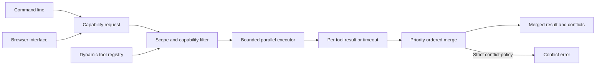

# Capability Tool Orchestrator

Route a capability to permitted tools, execute them concurrently, and merge outputs with deterministic priority rules.

Set `timeout_seconds` to bound orchestration latency and `conflict_policy="error"` when conflicting outputs must stop the workflow. Timed out handlers are cancelled when possible; in-flight Python threads must still implement their own I/O timeouts.

## Quick start

Requires Python 3.11 or newer. From this repository:

```powershell
python -m venv .venv
.\.venv\Scripts\Activate.ps1
python -m pip install -e '.[dev]'
pytest -q
```

On macOS or Linux:

```bash
python3 -m venv .venv
source .venv/bin/activate
python -m pip install -e '.[dev]'
pytest -q
```

This project uses deterministic tests and needs no model key for verification.

The installed `tool-orchestrator` command runs a manifest of scoped tools. Try `tool-orchestrator --manifest examples/tools.json run lookup '{"item":"42"}' --scope read`. The JSON manifest supports `static` tools and `http` tools that POST the payload to an HTTPS endpoint (or loopback in development); set `bearer_env` to an environment variable name for an endpoint token. Run `tool-orchestrator --manifest examples/tools.json serve --port 8080` for the local browser interface at `http://127.0.0.1:8080`. Only grant scopes a caller is authorized to use.

```python
from capability_tool_orchestrator.engine import Orchestrator, Tool

orchestrator = Orchestrator(max_workers=2)
orchestrator.register(Tool("catalog", frozenset({"lookup"}), frozenset({"read"}), lambda q: {"item": q["id"]}, priority=10))
print(orchestrator.execute("lookup", {"id": "42"}, granted_scopes={"read"}))
```

## Architecture



| Component | Responsibility |
|---|---|
| Registry | Maps tools to capabilities, scopes, and priority. |
| Executor | Runs eligible tools concurrently with an overall deadline. |
| Merger | Resolves values deterministically and reports conflicts. |

Capability request -> scope filter -> bounded thread pool -> per-tool result capture -> priority ordered merge -> conflict list.

See [ARCHITECTURE.md](ARCHITECTURE.md) for components, state, failure behavior, and operations.

## Deployment and safety

See [DEPLOYMENT.md](DEPLOYMENT.md) for the non-root container, token-protected browser, data mounts, and release checks.

The orchestrator does not cancel slow Python threads. Set timeouts in individual handlers. Conflicting values keep the highest priority tool's value and are listed for caller review.

Install this as a library in an authenticated application or worker. Register trusted handlers and keep application secrets outside source control.

## Verification

`pytest -q` runs deterministic tests. GitHub Actions runs the same suite on pushes and pull requests.

## License

MIT. See [LICENSE](LICENSE).
